# 机场组 · 64 项

名单来源：[DuyaoSS](https://www.duyaoss.com/archives/3/)，整理于 2026-10-24。正文 51 家，文末补充 9 家。

47 项参考原标重绘；13 项彩色文字设计版使用 `-wordmark.png` 文件名，名称标注“文字设计版”。手绘版本保留参考素材的主要配色和辨识结构。

[机场订阅](https://raw.githubusercontent.com/zwjtano/icons/main/airports.json) · [全部图标](icons.json) · [来源](AIRPORT-ICON-SOURCES.md)

| 预览 | 名称 | 类型 | 图片 |
| --- | --- | --- | --- |
| 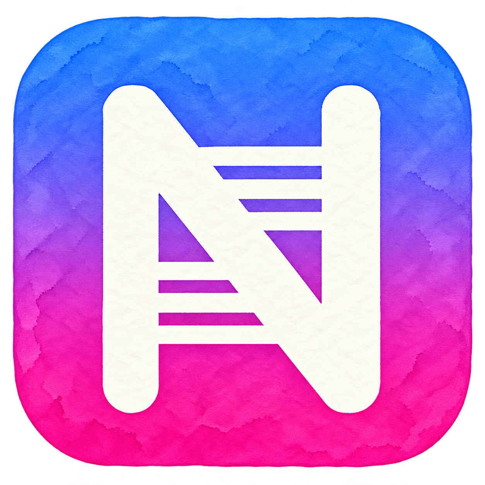 | 机场组 · 奶昔 Nexitally | 原标参考重绘 | [`nexitally.png`](https://raw.githubusercontent.com/zwjtano/icons/main/icons/nexitally.png?v=74b181fce0d3) |
| 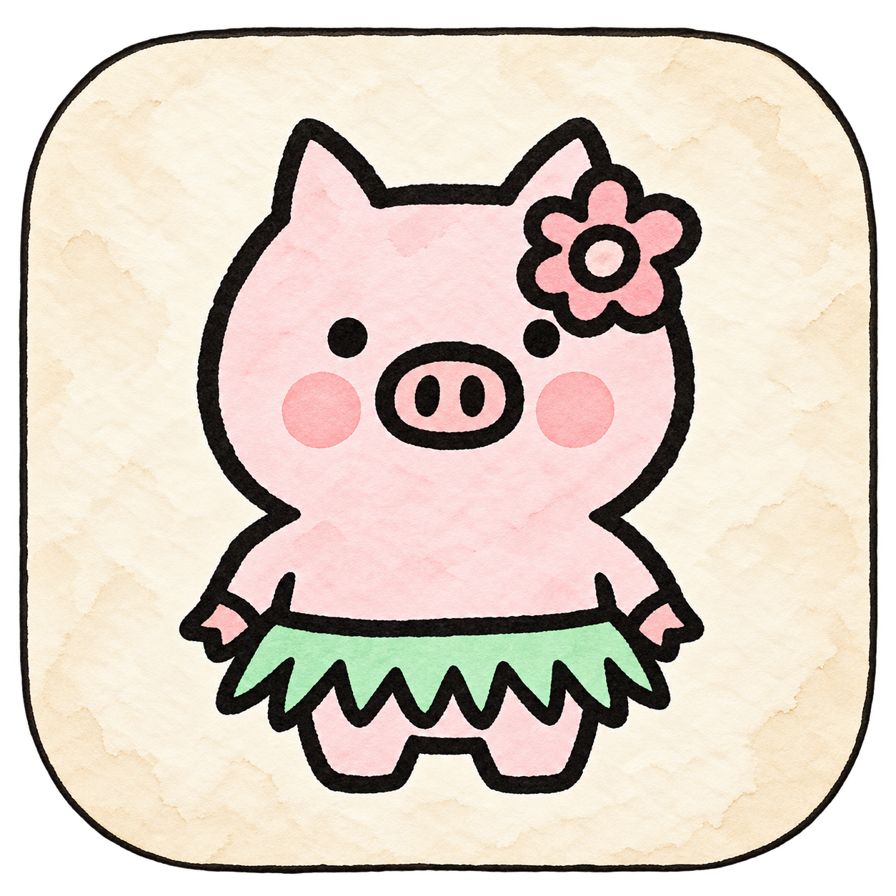 | 机场组 · 按摩院 AmyTelecom | 原标参考重绘 | [`amytelecom.png`](https://raw.githubusercontent.com/zwjtano/icons/main/icons/amytelecom.png?v=e09ccd5d6a7b) |
| 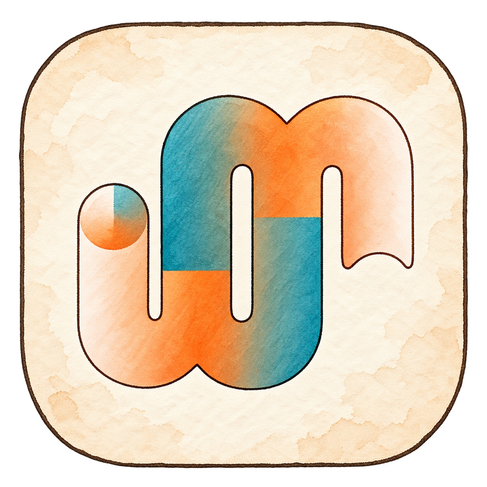 | 机场组 · ImmTel ImmTelecom | 原标参考重绘 | [`immtel.png`](https://raw.githubusercontent.com/zwjtano/icons/main/icons/immtel.png?v=5a4c5b5d32bc) |
|  | 机场组 · 花云 FlowerCloud | 原标参考重绘 | [`flowercloud.png`](https://raw.githubusercontent.com/zwjtano/icons/main/icons/flowercloud.png?v=c32bb8312246) |
|  | 机场组 · YToo YTOO | 原标参考重绘 | [`ytoo.png`](https://raw.githubusercontent.com/zwjtano/icons/main/icons/ytoo.png?v=60b63e8e4188) |
|  | 机场组 · 库洛米Kuromis | 原标参考重绘 | [`kuromis.png`](https://raw.githubusercontent.com/zwjtano/icons/main/icons/kuromis.png?v=b61224c20ad6) |
|  | 机场组 · 奶油 CreamData | 原标参考重绘 | [`creamdata.png`](https://raw.githubusercontent.com/zwjtano/icons/main/icons/creamdata.png?v=024bfa0094d9) |
| 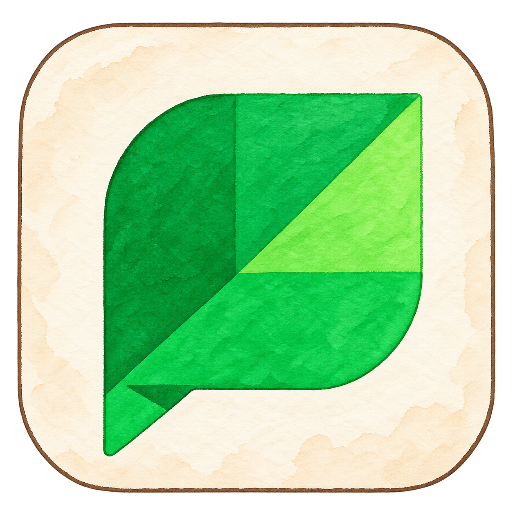 | 机场组 · LinkCube | 原标参考重绘 | [`linkcube.png`](https://raw.githubusercontent.com/zwjtano/icons/main/icons/linkcube.png?v=ec785a2693a0) |
| 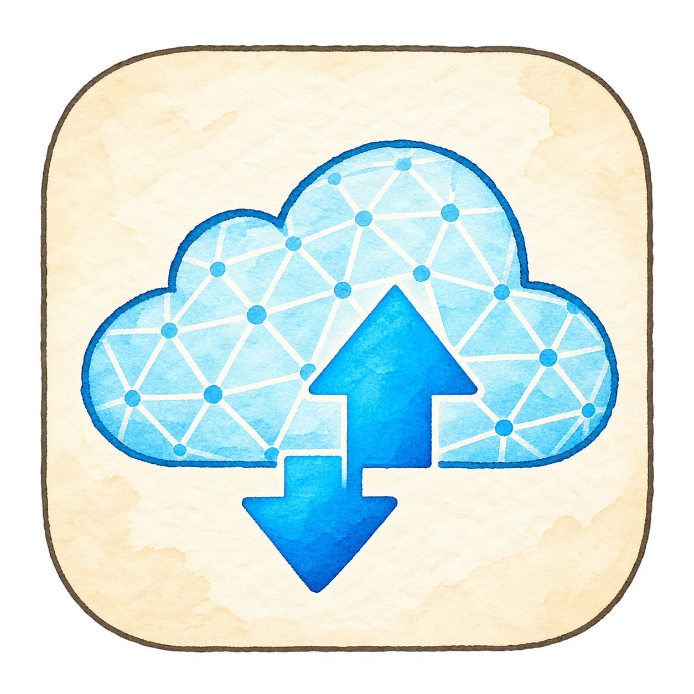 | 机场组 · 西部数据 WestData WDCloud | 原标参考重绘 | [`wdcloud.png`](https://raw.githubusercontent.com/zwjtano/icons/main/icons/wdcloud.png?v=12413295a4ca) |
|  | 机场组 · 飞鸟 FlyingBird 文字设计版 | 彩色文字设计版 | [`flyingbird-wordmark.png`](https://raw.githubusercontent.com/zwjtano/icons/main/icons/flyingbird-wordmark.png?v=ac02a50046e3) |
| 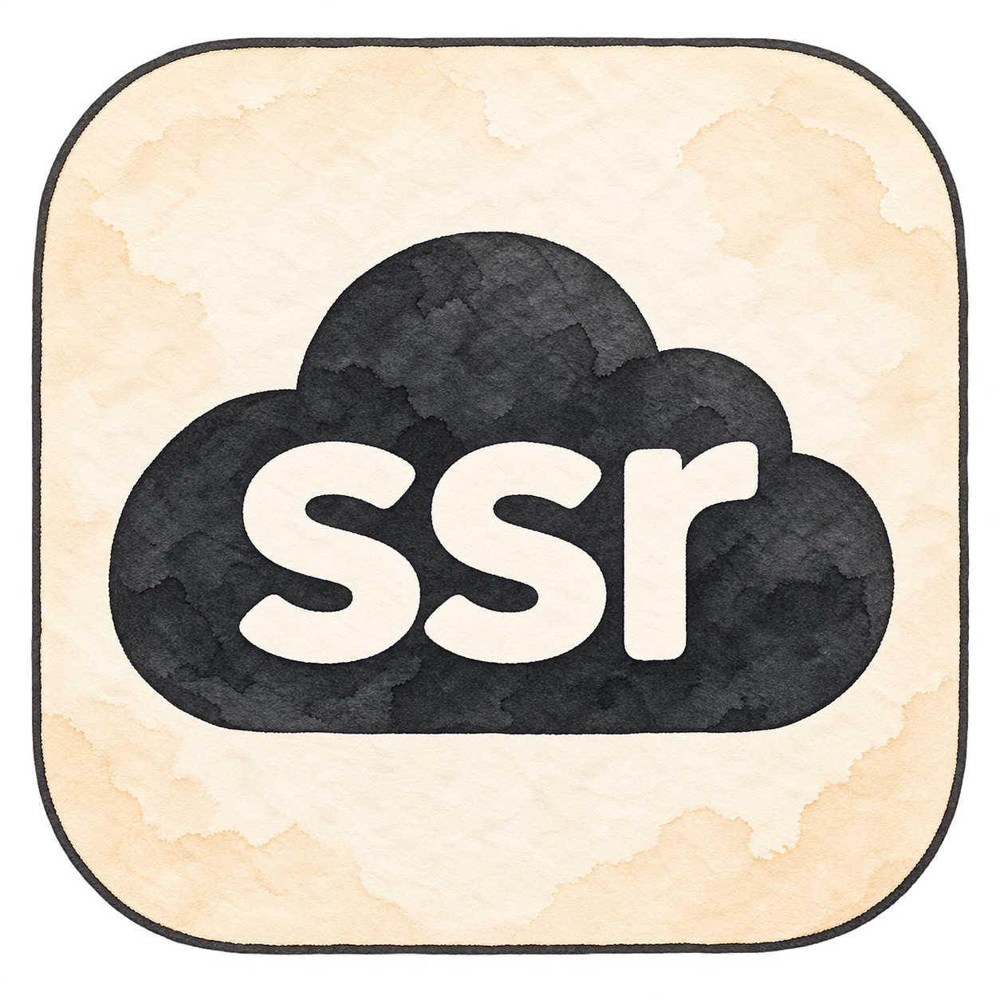 | 机场组 · ssrcloud | 原标参考重绘 | [`ssrcloud.png`](https://raw.githubusercontent.com/zwjtano/icons/main/icons/ssrcloud.png?v=d4cb0bb816b2) |
|  | 机场组 · FastLink | 原标参考重绘 | [`fastlink.png`](https://raw.githubusercontent.com/zwjtano/icons/main/icons/fastlink.png?v=589e13842422) |
| 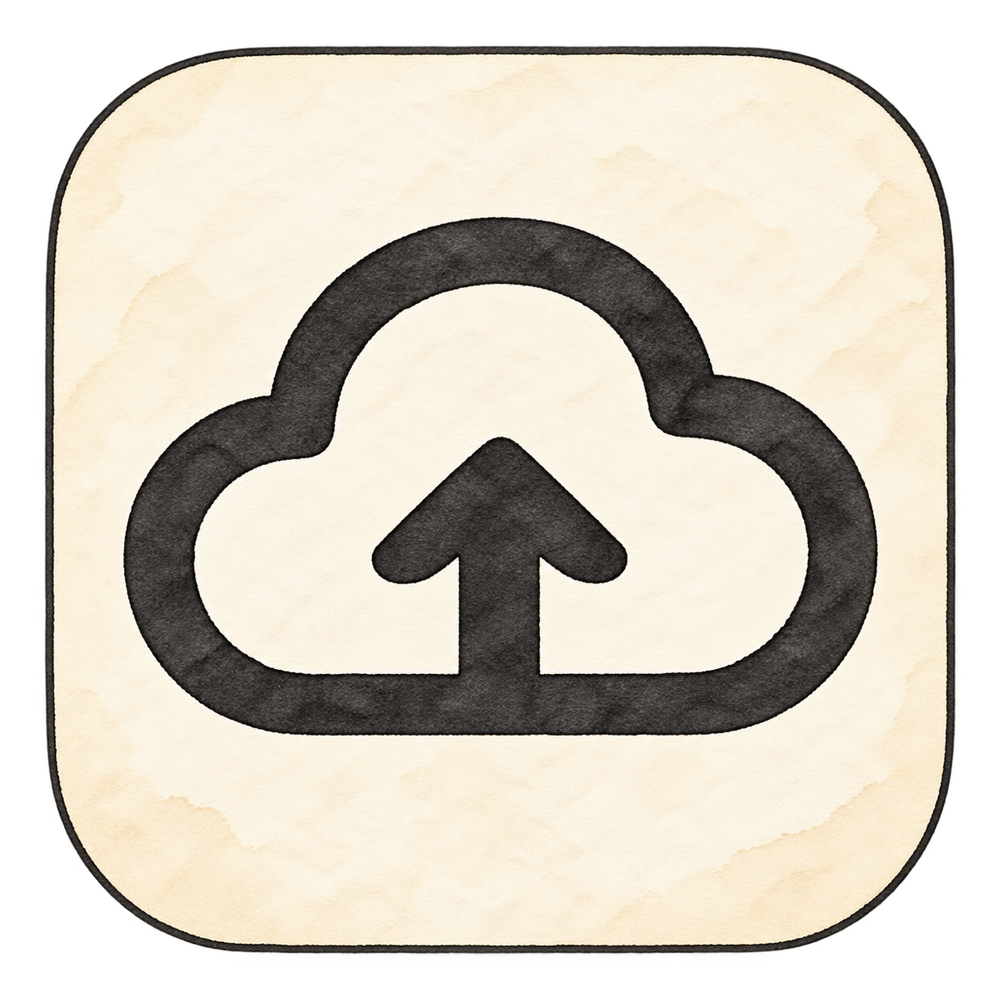 | 机场组 · yiyunti 一云梯 | 原标参考重绘 | [`yiyunti.png`](https://raw.githubusercontent.com/zwjtano/icons/main/icons/yiyunti.png?v=a4f53fb04705) |
|  | 机场组 · Luckin | 原标参考重绘 | [`luckin.png`](https://raw.githubusercontent.com/zwjtano/icons/main/icons/luckin.png?v=89fccef0fa99) |
|  | 机场组 · paofuyun 泡芙云 | 原标参考重绘 | [`paofuyun.png`](https://raw.githubusercontent.com/zwjtano/icons/main/icons/paofuyun.png?v=18d5477335e6) |
| 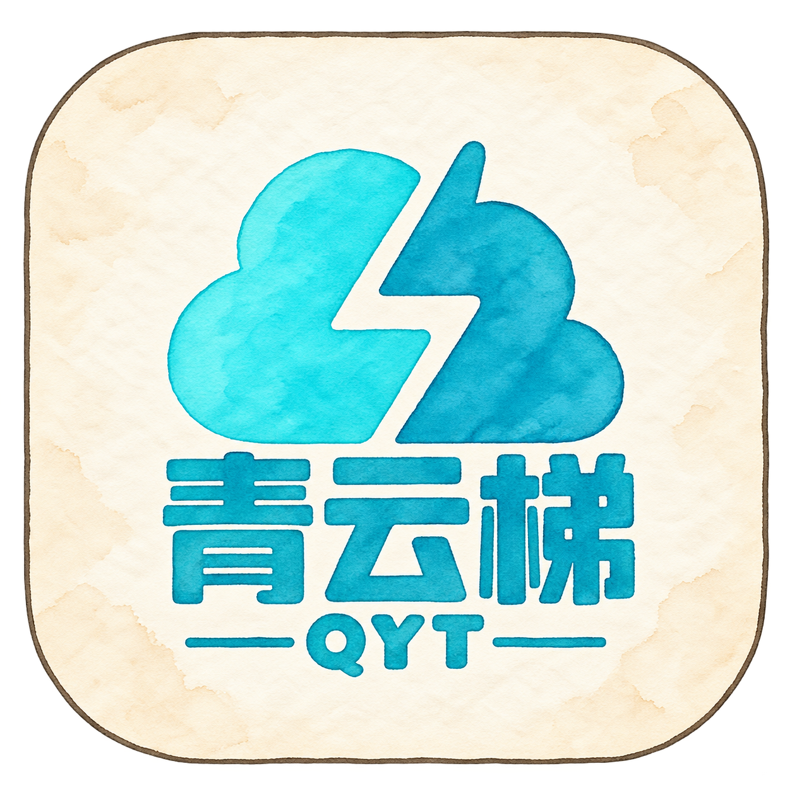 | 机场组 · qingyunti 青云梯 | 原标参考重绘 | [`qingyunti.png`](https://raw.githubusercontent.com/zwjtano/icons/main/icons/qingyunti.png?v=dba28da6bc2c) |
|  | 机场组 · KyCloud 文字设计版 | 彩色文字设计版 | [`kycloud-wordmark.png`](https://raw.githubusercontent.com/zwjtano/icons/main/icons/kycloud-wordmark.png?v=7bc27d397696) |
|  | 机场组 · 咸鱼加速器 NexusCloud 文字设计版 | 彩色文字设计版 | [`nexuscloud-wordmark.png`](https://raw.githubusercontent.com/zwjtano/icons/main/icons/nexuscloud-wordmark.png?v=4a69a91fe7f8) |
|  | 机场组 · longmaoyun 龙猫云 | 原标参考重绘 | [`longmaoyun.png`](https://raw.githubusercontent.com/zwjtano/icons/main/icons/longmaoyun.png?v=f81c8595adc5) |
|  | 机场组 · myjs 魅影极速 MAYING | 原标参考重绘 | [`myjs.png`](https://raw.githubusercontent.com/zwjtano/icons/main/icons/myjs.png?v=276f03206af4) |
|  | 机场组 · ARK | 原标参考重绘 | [`ark.png`](https://raw.githubusercontent.com/zwjtano/icons/main/icons/ark.png?v=a269de2748ef) |
|  | 机场组 · V2Tun | 原标参考重绘 | [`v2tun.png`](https://raw.githubusercontent.com/zwjtano/icons/main/icons/v2tun.png?v=ed3b5966e903) |
|  | 机场组 · 酷酷云KuKuYun | 原标参考重绘 | [`kukuyun.png`](https://raw.githubusercontent.com/zwjtano/icons/main/icons/kukuyun.png?v=c228dfb037b0) |
| 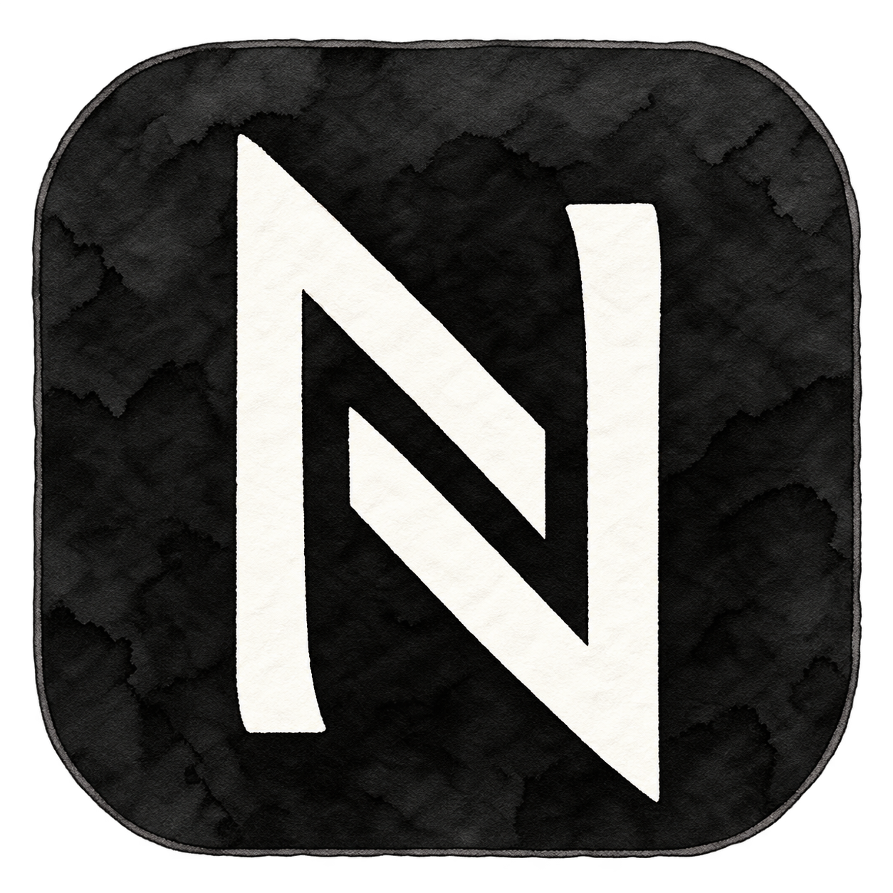 | 机场组 · Nerwo奶瓶 | 原标参考重绘 | [`nerwo.png`](https://raw.githubusercontent.com/zwjtano/icons/main/icons/nerwo.png?v=af65ca03270b) |
| 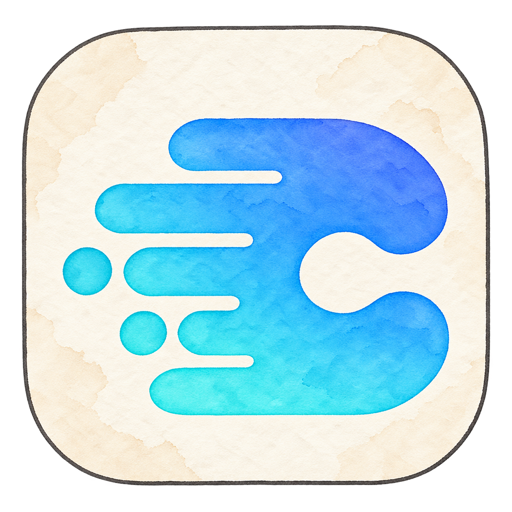 | 机场组 · cyou 次元链接 CyLink Cylink | 原标参考重绘 | [`cyou.png`](https://raw.githubusercontent.com/zwjtano/icons/main/icons/cyou.png?v=4f519e8c5955) |
|  | 机场组 · xiaoxuanfeng 小旋风 文字设计版 | 彩色文字设计版 | [`xiaoxuanfeng-wordmark.png`](https://raw.githubusercontent.com/zwjtano/icons/main/icons/xiaoxuanfeng-wordmark.png?v=5c03f5a56e0c) |
|  | 机场组 · 闪狐云 FlashFox | 原标参考重绘 | [`flashfox.png`](https://raw.githubusercontent.com/zwjtano/icons/main/icons/flashfox.png?v=3284f705c1ff) |
| 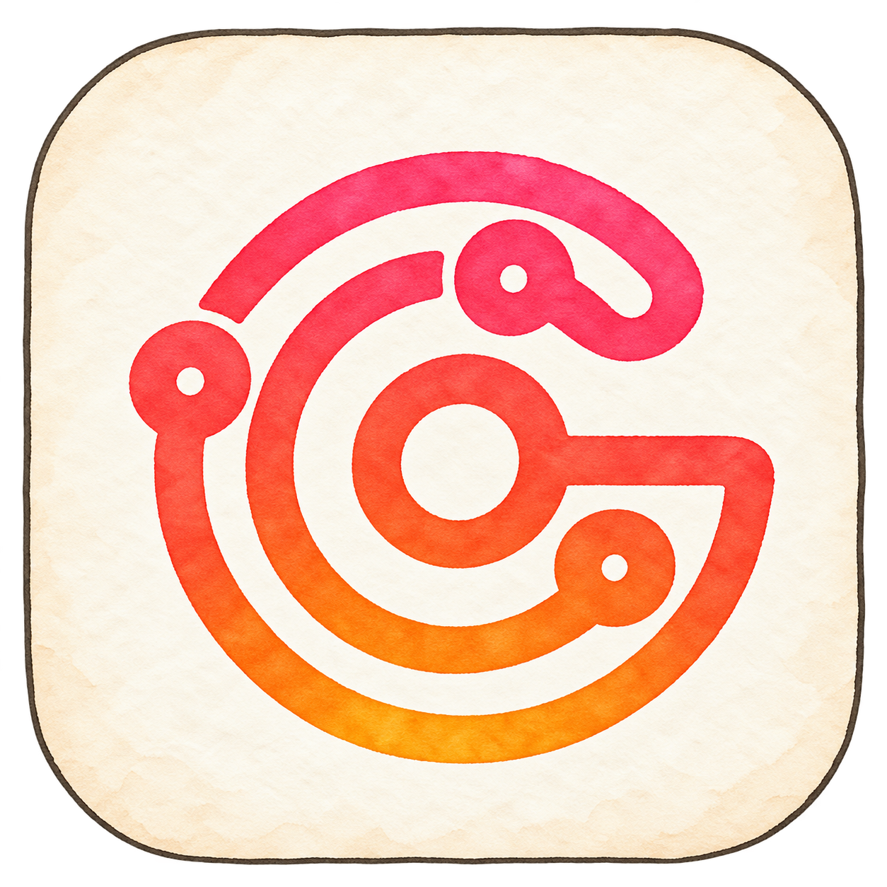 | 机场组 · 银河云GalaxyCloud | 原标参考重绘 | [`galaxycloud.png`](https://raw.githubusercontent.com/zwjtano/icons/main/icons/galaxycloud.png?v=8404338c950b) |
|  | 机场组 · 飞天猪 Fliggy 文字设计版 | 彩色文字设计版 | [`fliggy-wordmark.png`](https://raw.githubusercontent.com/zwjtano/icons/main/icons/fliggy-wordmark.png?v=896d2f7e9113) |
|  | 机场组 · suyunti 速云梯 文字设计版 | 彩色文字设计版 | [`suyunti-wordmark.png`](https://raw.githubusercontent.com/zwjtano/icons/main/icons/suyunti-wordmark.png?v=c856303b01c9) |
|  | 机场组 · feijicloud 飞机云 文字设计版 | 彩色文字设计版 | [`feijicloud-wordmark.png`](https://raw.githubusercontent.com/zwjtano/icons/main/icons/feijicloud-wordmark.png?v=bfe047f66309) |
| 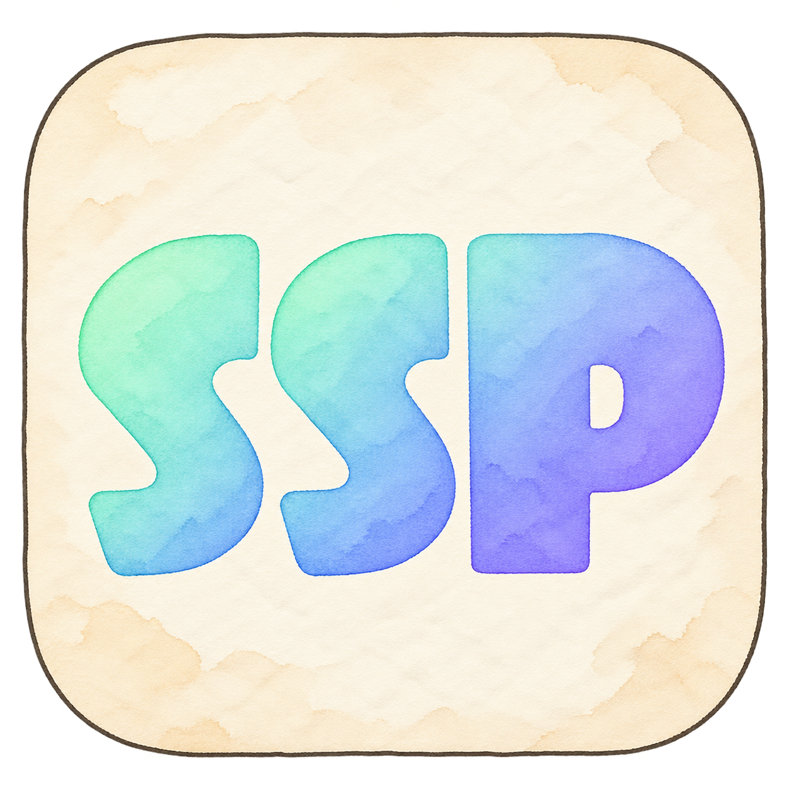 | 机场组 · shaoshupai 少数派 SSP | 原标参考重绘 | [`shaoshupai.png`](https://raw.githubusercontent.com/zwjtano/icons/main/icons/shaoshupai.png?v=ade1f9abbd68) |
|  | 机场组 · 白月光 ByWave | 原标参考重绘 | [`bywave.png`](https://raw.githubusercontent.com/zwjtano/icons/main/icons/bywave.png?v=eaf17aa2325f) |
|  | 机场组 · Aladdin | 原标参考重绘 | [`aladdin.png`](https://raw.githubusercontent.com/zwjtano/icons/main/icons/aladdin.png?v=729207e033d2) |
|  | 机场组 · KooDog | 原标参考重绘 | [`koodog.png`](https://raw.githubusercontent.com/zwjtano/icons/main/icons/koodog.png?v=e490ec1a3ece) |
|  | 机场组 · shouhou 守候网络 | 原标参考重绘 | [`shouhou.png`](https://raw.githubusercontent.com/zwjtano/icons/main/icons/shouhou.png?v=6eeedce385a5) |
| 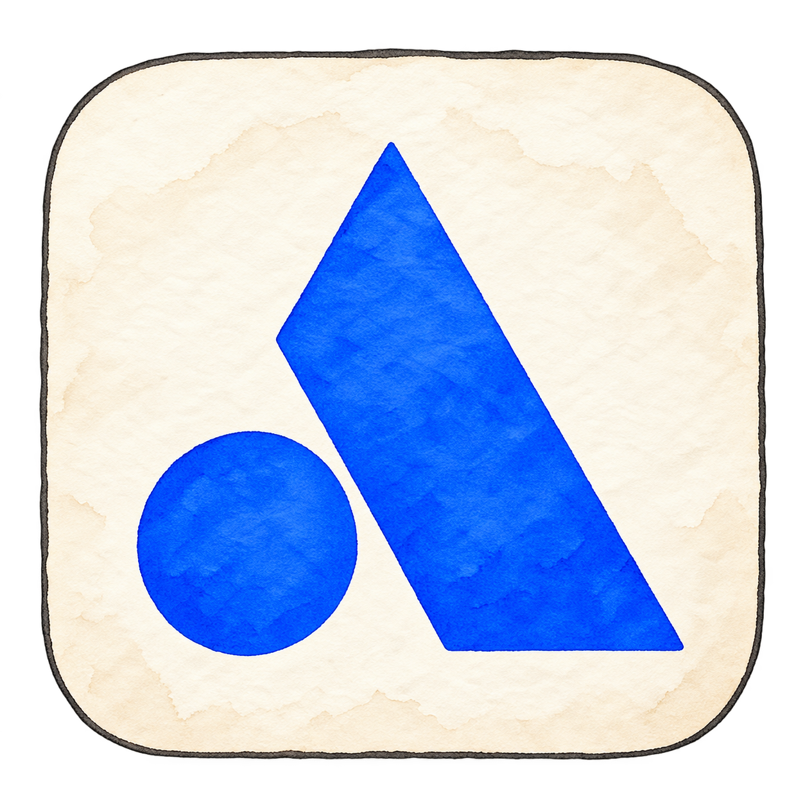 | 机场组 · ASH | 原标参考重绘 | [`ash.png`](https://raw.githubusercontent.com/zwjtano/icons/main/icons/ash.png?v=60331492af4d) |
|  | 机场组 · V2Paw | 原标参考重绘 | [`v2paw.png`](https://raw.githubusercontent.com/zwjtano/icons/main/icons/v2paw.png?v=fbe81b0609da) |
| 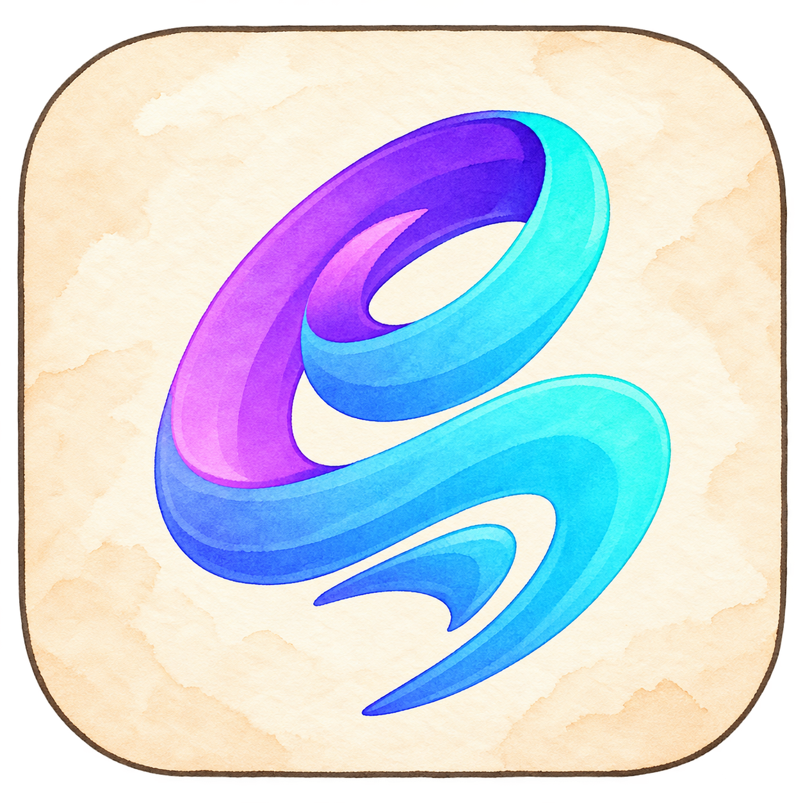 | 机场组 · ssLinks | 原标参考重绘 | [`sslinks.png`](https://raw.githubusercontent.com/zwjtano/icons/main/icons/sslinks.png?v=64a7f3bd46fc) |
|  | 机场组 · foo-and-friends Foo&Friends FNF | 原标参考重绘 | [`foo-and-friends.png`](https://raw.githubusercontent.com/zwjtano/icons/main/icons/foo-and-friends.png?v=d48c5f0e8cae) |
|  | 机场组 · Xlinkworld | 原标参考重绘 | [`xlinkworld.png`](https://raw.githubusercontent.com/zwjtano/icons/main/icons/xlinkworld.png?v=edf289577cc5) |
| 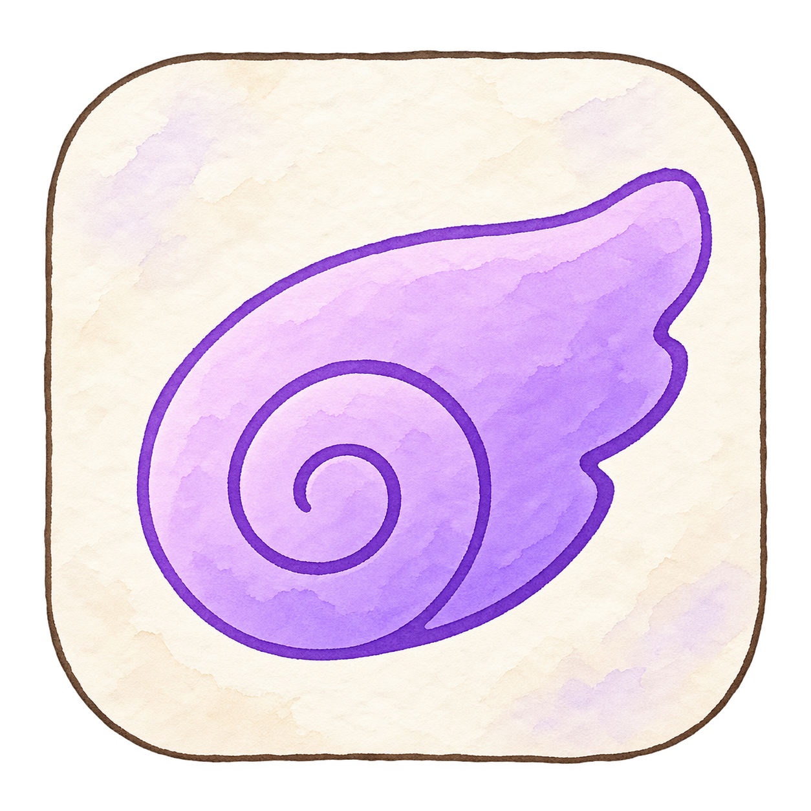 | 机场组 · yunyi 云翼网络 | 原标参考重绘 | [`yunyi.png`](https://raw.githubusercontent.com/zwjtano/icons/main/icons/yunyi.png?v=ac6ef0565ace) |
|  | 机场组 · dagcloud 大哥云 DGY | 原标参考重绘 | [`dagcloud.png`](https://raw.githubusercontent.com/zwjtano/icons/main/icons/dagcloud.png?v=e2ad84292bfb) |
| 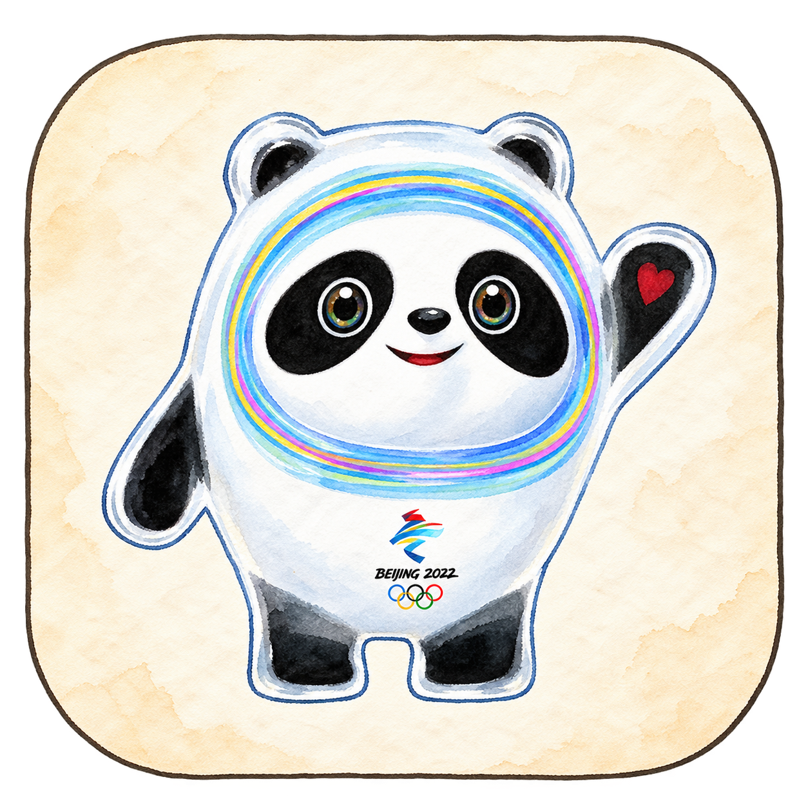 | 机场组 · maoxiong 猫熊网络 | 原标参考重绘 | [`maoxiong.png`](https://raw.githubusercontent.com/zwjtano/icons/main/icons/maoxiong.png?v=15de5ca48a30) |
|  | 机场组 · 纷达网络 Fenda Funda | 原标参考重绘 | [`funda.png`](https://raw.githubusercontent.com/zwjtano/icons/main/icons/funda.png?v=21d41dada9ff) |
| 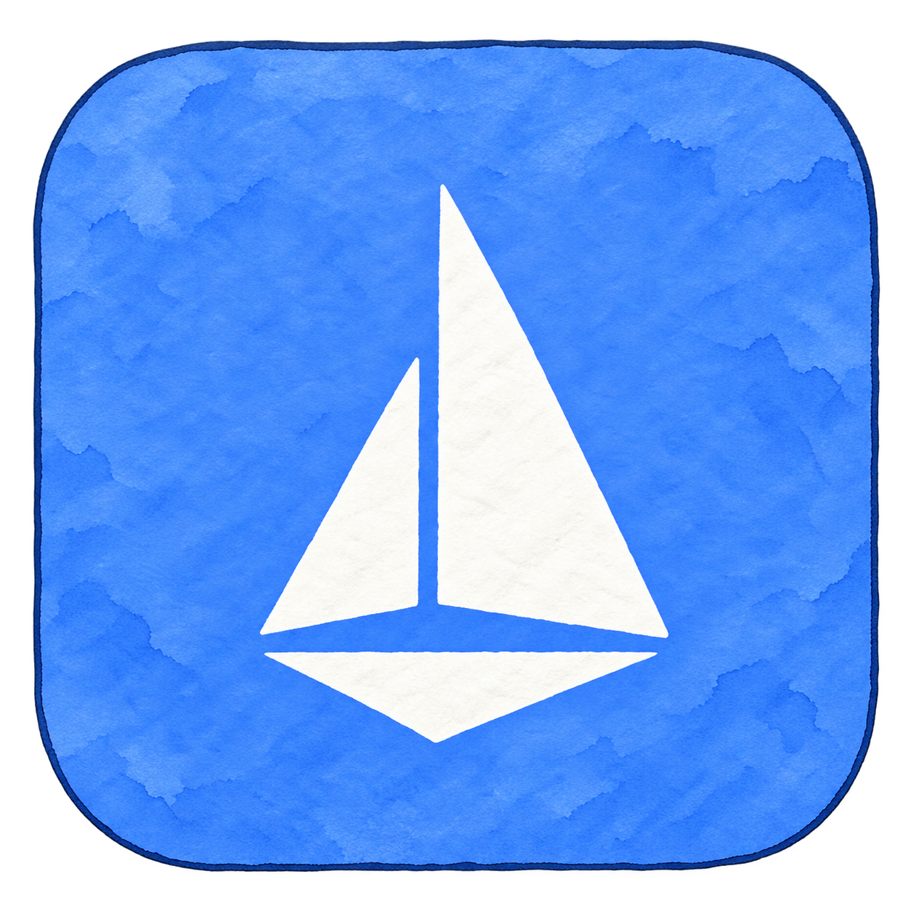 | 机场组 · lanfanyun 蓝帆云 | 原标参考重绘 | [`lanfanyun.png`](https://raw.githubusercontent.com/zwjtano/icons/main/icons/lanfanyun.png?v=bf9d6c05f6b4) |
|  | 机场组 · jifengyun 疾风云 文字设计版 | 彩色文字设计版 | [`jifengyun-wordmark.png`](https://raw.githubusercontent.com/zwjtano/icons/main/icons/jifengyun-wordmark.png?v=7ae836a776f9) |
|  | 机场组 · erwans 尔湾云 文字设计版 | 彩色文字设计版 | [`erwans-wordmark.png`](https://raw.githubusercontent.com/zwjtano/icons/main/icons/erwans-wordmark.png?v=c92a57449358) |
|  | 机场组 · Flyint飞数 | 原标参考重绘 | [`flyint.png`](https://raw.githubusercontent.com/zwjtano/icons/main/icons/flyint.png?v=4b9bdb776b0b) |
|  | 机场组 · MESL | 原标参考重绘 | [`mesl.png`](https://raw.githubusercontent.com/zwjtano/icons/main/icons/mesl.png?v=e0103cde5764) |
|  | 机场组 · tianhang 天航 文字设计版 | 彩色文字设计版 | [`tianhang-wordmark.png`](https://raw.githubusercontent.com/zwjtano/icons/main/icons/tianhang-wordmark.png?v=95c966e69032) |
| 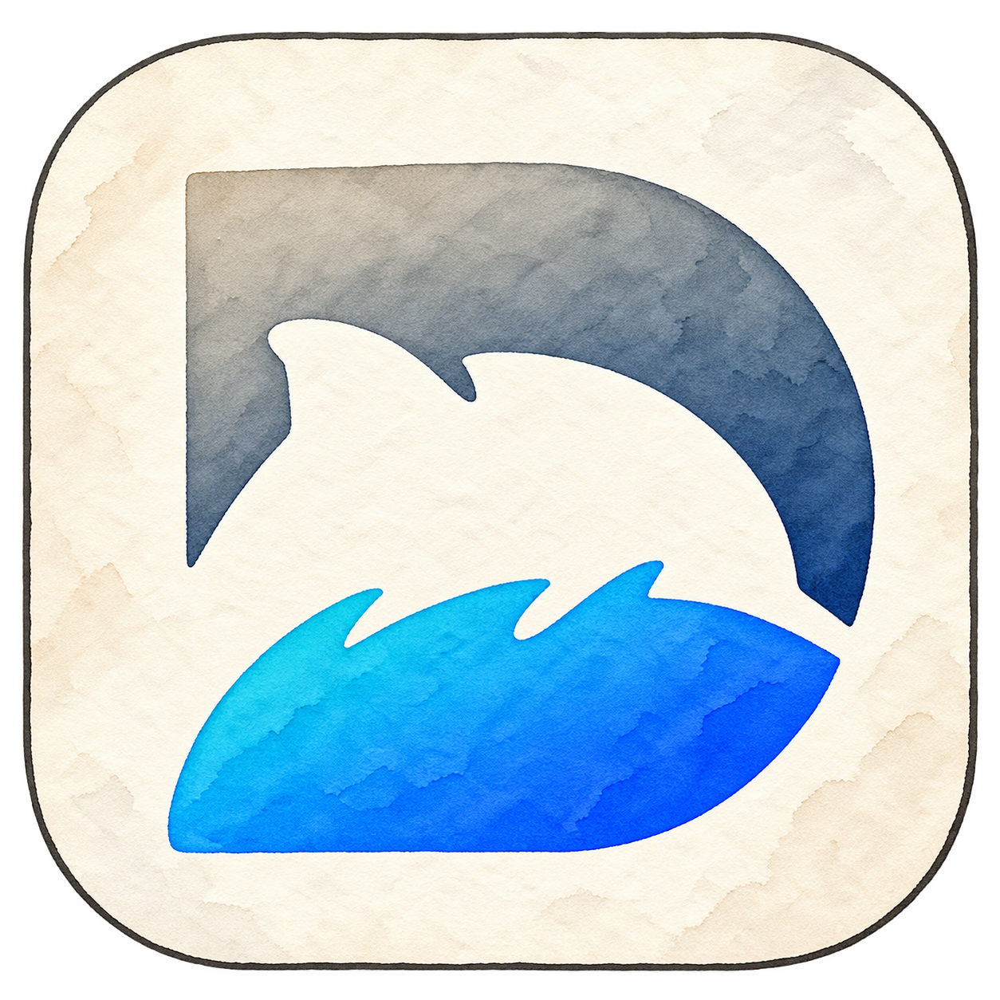 | 机场组 · haitunwan 海豚湾 Hitun | 原标参考重绘 | [`haitunwan.png`](https://raw.githubusercontent.com/zwjtano/icons/main/icons/haitunwan.png?v=573e7766e7d5) |
|  | 机场组 · 速鹰666 Suying666 文字设计版 | 彩色文字设计版 | [`suying666-wordmark.png`](https://raw.githubusercontent.com/zwjtano/icons/main/icons/suying666-wordmark.png?v=7b41024592fa) |
|  | 机场组 · 三月七 March7 文字设计版 | 彩色文字设计版 | [`march7-wordmark.png`](https://raw.githubusercontent.com/zwjtano/icons/main/icons/march7-wordmark.png?v=f26d2e11199d) |
|  | 机场组 · Yepfast椰皮加速 | 原标参考重绘 | [`yepfast.png`](https://raw.githubusercontent.com/zwjtano/icons/main/icons/yepfast.png?v=711f76ef7f2e) |
|  | 机场组 · OuO Network | 原标参考重绘 | [`ouo.png`](https://raw.githubusercontent.com/zwjtano/icons/main/icons/ouo.png?v=2ac79eb1bacb) |
| 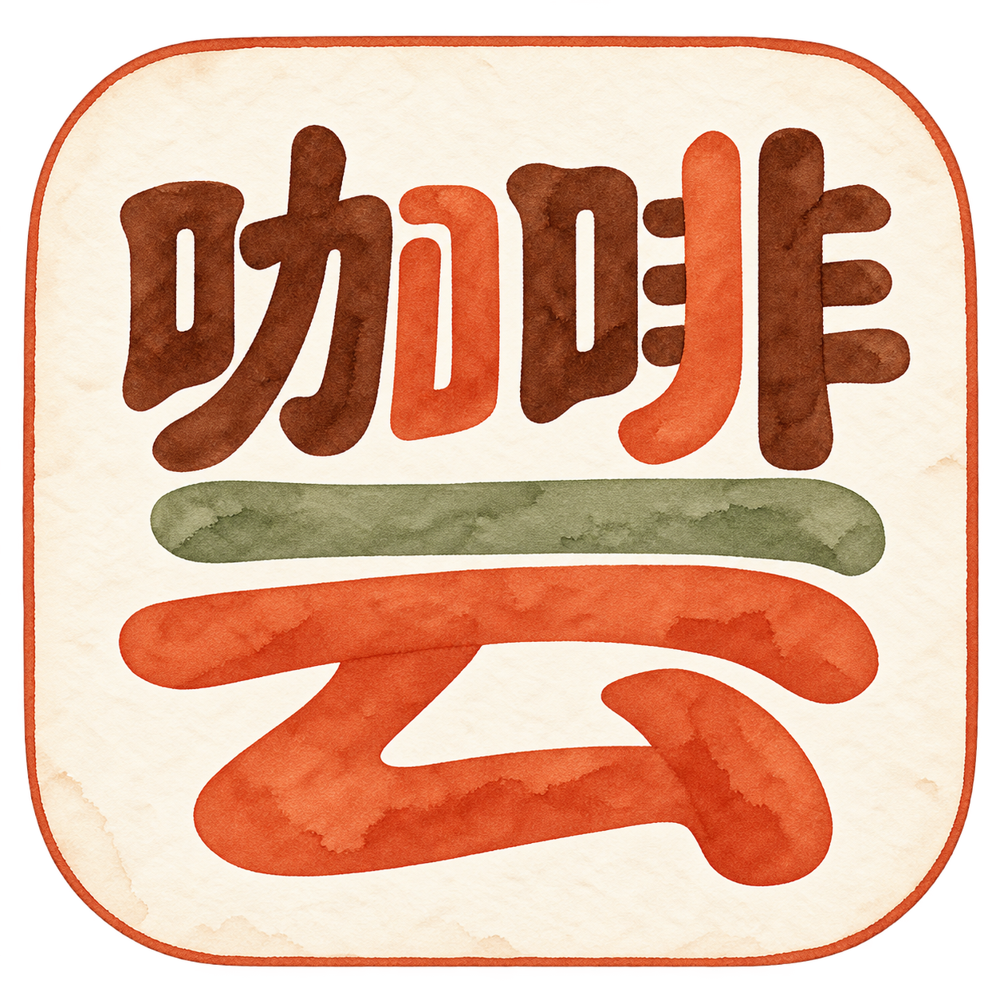 | 机场组 · 咖啡云 CoffeeCloud 文字设计版 | 彩色文字设计版 | [`coffeecloud-wordmark.png`](https://raw.githubusercontent.com/zwjtano/icons/main/icons/coffeecloud-wordmark.png?v=c42513b66f96) |
|  | 机场组 · FastNode | 原标参考重绘 | [`fastnode.png`](https://raw.githubusercontent.com/zwjtano/icons/main/icons/fastnode.png?v=eb7a88ac493a) |
|  | 机场组 · Miaona | 原标参考重绘 | [`miaona.png`](https://raw.githubusercontent.com/zwjtano/icons/main/icons/miaona.png?v=150145840cca) |
|  | 机场组 · AgentNEO | 原标参考重绘 | [`agentneo.png`](https://raw.githubusercontent.com/zwjtano/icons/main/icons/agentneo.png?v=d16bdc3e030d) |

## 同组配套图标

按用户要求将现有 Loon、Surge、TAG、WD 一并归入机场组，沿用现有图片直链。机场组订阅共 64 项，位于应用合集的连续末尾区块。

| 预览 | 名称 | 图片 |
| --- | --- | --- |
|  | 机场组 · loon 代理 | [图片](https://raw.githubusercontent.com/zwjtano/icons/main/icons/loon.png) |
|  | 机场组 · surge 网络代理 | [图片](https://raw.githubusercontent.com/zwjtano/icons/main/icons/surge.png) |
|  | 机场组 · tag 标签 | [图片](https://raw.githubusercontent.com/zwjtano/icons/main/icons/tag.png?v=daeb583d99e9) |
|  | 机场组 · wd 西部数据 Western Digital | [图片](https://raw.githubusercontent.com/zwjtano/icons/main/icons/wd.png) |
