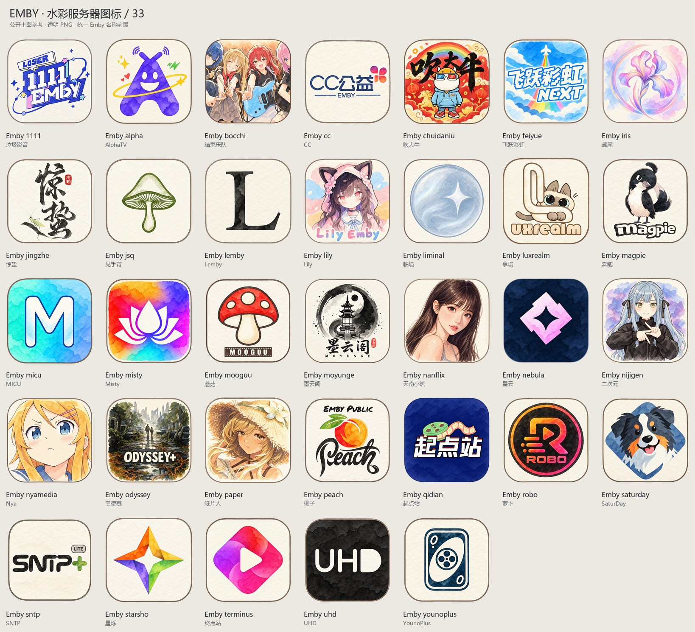
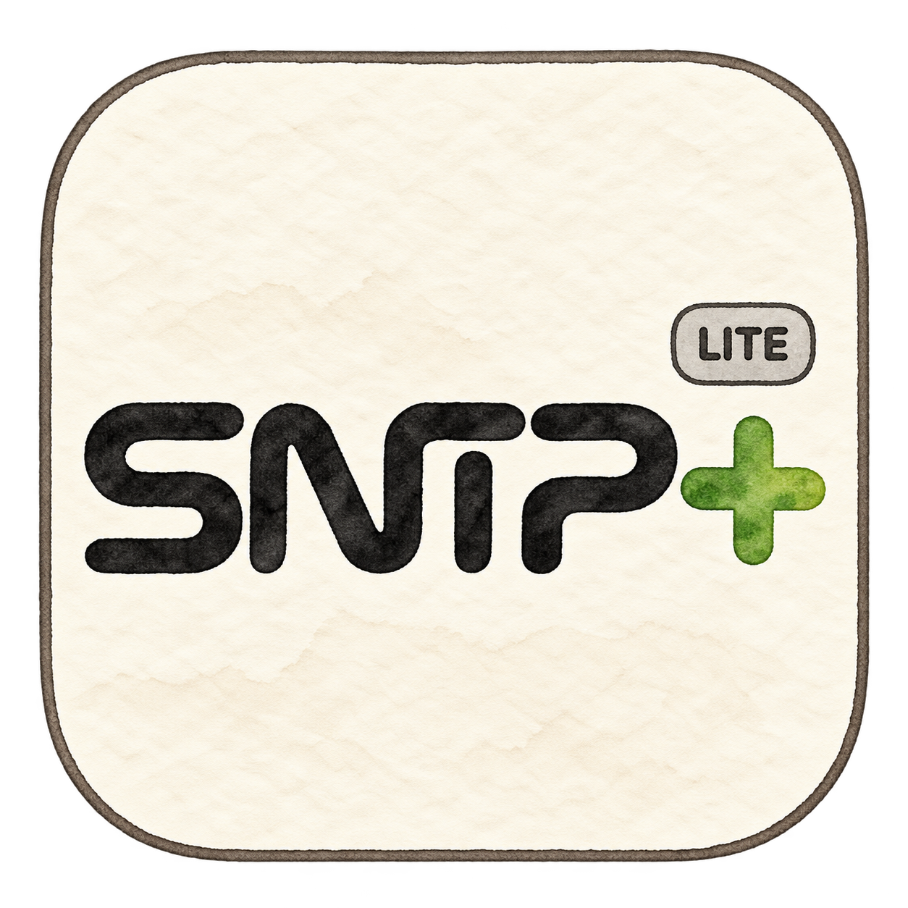

# Emby 服务器图标目录

核对日期：2026-10-24。收录 33 个公开品牌图标，适配本仓库水彩纸纹风格。所有客户端显示名称以 `Emby` 开头，图片文件名以 `emby-` 开头，便于搜索和按名称集中显示。

[Emby 专用订阅](https://raw.githubusercontent.com/zwjtano/icons/main/emby.json) · [来源与改绘说明](EMBY-ICON-SOURCES.md) · [机器可读索引](emby-index.json)

“常见”指公开导航、社区或已有维护项目中可检索到的服务品牌，并非市场占有率排名。只核对公开页面、头像和可见公告，未注册、登录或测试播放。兼容 Emby 协议的自研服务端与历史品牌已在下表分别注明；UHD 是自研 Next Media Server，并非原版 Emby 服务端。

| 图标 | 品牌 | 公开入口 | 核对备注 |
| --- | --- | --- | --- |
|  | Emby 垃圾影音 1111 Loser | [公开页面](https://t.me/+Dmbz1JHHv1k4ZTJl) | 公开邀请落地页名称为垃圾影音更新通知，已核对其 1111 EMBY 头像。 [依据](https://t.me/+Dmbz1JHHv1k4ZTJl) |
|  | Emby AlphaTV 海外服 Alpha | [公开页面](https://t.me/AlphaTVOverseaChannel) | 公开通知频道及头像已核对；2026-09 有用户余额活动公告。 [依据](https://t.me/AlphaTVOverseaChannel/166) |
|  | Emby 结束乐队 結束Band Bocchi AIVBI | [公开页面](https://t.me/plus_emby) | 公开频道现名 Re:結束Band，简介与 plusemby 群互相关联；按现名收录。 [依据](https://t.me/plus_emby) |
|  | Emby CC 公益 CcEmby | [公开页面](https://t.me/CcEmby) | 公开频道及头像已核对；最近可见服务公告为 2026-02-07 线路恢复。 [依据](https://t.me/CcEmby/260) |
|  | Emby 吹大牛 飞跃 飛躍 ChuiDaNiu | [公开页面](https://t.me/chuidab) | 公开群现名飞跃吹大牛公费服；Dpx 频道 2026-02-05 发布迁移安排。 [依据](https://t.me/dpxpindao/236) |
|  | Emby 飞跃彩虹 飛躍彩虹 Feiyue NEXT | [公开页面](https://t.me/fyemby) | 公开飞跃彩虹通知频道采用 NEXT 主图；仅作为品牌识别收录。 [依据](https://t.me/fyemby) |
|  | Emby 鸢尾 鳶尾 Iris | [公开页面](https://t.me/IrisEmby_Group) | 2026-10-22 频道发布 10 月 26—27 日例行维护安排。 [依据](https://t.me/Iris_notice/63) |
|  | Emby 惊蛰 驚蟄 Jingzhe JINGZHEPRO | [公开页面](https://t.me/jz_emby) | 公开频道 JINGZHEPRO 含该品牌账号管理说明，采用惊蛰书法主图；未实测播放。 [依据](https://t.me/jz_emby) |
|  | Emby 见手青 見手青 JianShouQing | [公开页面](https://t.me/jsq_channel) | 旧通知频道最近可见迁群公告为 2025-03-12，新群 mooguujsq；保留品牌识别。 [依据](https://t.me/jsq_channel/54) |
|  | Emby Lemby | [公开页面](https://t.me/Lemby_Channel) | 公开通知频道与现有维护项目支持列表交叉核对；主图为黑色衬线字母 L。 [依据](https://t.me/Lemby_Channel) |
|  | Emby Lily 百合 | [公开页面](https://t.me/lilyembybot) | 公开账号管理机器人自述为 Lily-Emby，并链接原频道；使用服务机器人头像，未采用个人照片。运营状态未实测。 [依据](https://t.me/lilyembybot) |
|  | Emby 临境 臨境 Liminal | [公开页面](https://t.me/LiminalChannel) | 2026-10-21 公告发布 302 Next 新架构内测。 [依据](https://t.me/LiminalChannel/330) |
|  | Emby 享境 Luxrealm | [公开页面](https://t.me/luxrealm_channel) | 公开频道与头像已核对；与临境联合发布线路说明。 [依据](https://t.me/Luxrealm_Channel/118) |
|  | Emby 喜鹊 喜鵲 Magpie | [公开页面](https://t.me/magpie_notify_bot) | 公开 Magpie 通知机器人头像已核对，主图为喜鹊形象。 [依据](https://t.me/magpie_notify_bot) |
|  | Emby MICU Cloud Media | [公开页面](https://t.me/micu_user_bot) | 公开账号机器人明确名为 MICU Cloud Media，使用机器人主图；未登录私人群组。 [依据](https://t.me/micu_user_bot) |
|  | Emby Misty 历史品牌 歷史品牌 UHD | [公开页面](https://t.me/FreeEmbyChannel) | 历史品牌：2025-11-24 已公告 Bot 停止并计划转向 UHD；不列为当前 Emby 可用服务。 [依据](https://t.me/FreeEmbyChannel/565) |
|  | Emby 蘑菇 Mooguu | [公开页面](https://t.me/mooguudepindao) | 公开通知频道和蘑菇头像已核对；频道 2026-10 有服务相关公告。 [依据](https://t.me/mooguudepindao) |
|  | Emby 墨云阁 墨雲閣 MoYunGe | [公开页面](https://t.me/mobaishishuaige) | 公开群介绍明确关联 MoYunGeBoss_bot，采用墨云阁水墨阁楼主图。 [依据](https://t.me/mobaishishuaige) |
|  | Emby 天南小筑 天南小築 Nanflix | [公开页面](https://t.me/Nanflix) | 公开频道现名 Nanflix@emby，2026-10-24 仍有媒体更新推送；使用当前频道插画头像。 [依据](https://t.me/Nanflix) |
|  | Emby 星云 星雲 Nebula Media | [公开页面](https://t.me/Nebula_Media) | 旧频道指向 Nebula_Media；新频道简介及头像已核对。 [依据](https://t.me/Nebula_Media) |
|  | Emby 二次元 Nijigen | [公开页面](https://t.me/nijigen_emby) | 公开频道和头像已核对；服务可用性未实测。 [依据](https://t.me/nijigen_emby) |
|  | Emby Nya Media Nyamedia | [公开页面](https://t.me/nyamedia_chat) | 公开群简介明确提供媒体服务及管理机器人；头像已核对。 [依据](https://t.me/nyamedia_chat) |
|  | Emby 奥德赛 奧德賽 Odyssey+ | [公开页面](https://t.me/odysseyplus) | 公开频道持续发布影视资讯；服务可用性未实测。 [依据](https://t.me/odysseyplus) |
|  | Emby 纸片人 紙片人 EmbyPlus Paper | [公开页面](https://t.me/embypluschannel) | 旧服 2026-09-24 停服；2026-10-15 频道另有新活动。旧服账号不能视为仍有效。 [依据](https://t.me/embypluschannel/141) |
|  | Emby 桃子 Peach | [公开页面](https://t.me/peachemby_channel) | 2026-10-14 公告要求通过机器人获取新线路。 [依据](https://t.me/peachemby_channel/69) |
|  | Emby 起点站 起點站 Qidian | [公开页面](https://t.me/tdck_emby) | 2026-05-05 公告说明迁至管理面板与 Emby 协议兼容服务端。 [依据](https://t.me/tdck_emby/149) |
|  | Emby 萝卜 蘿蔔 Robo | [公开页面](https://t.me/roboemby) | 公开通知频道自述 Robo 快看 Emby 影视库，并关联账号机器人。 [依据](https://t.me/roboemby) |
|  | Emby SaturDay Lite 星期六 | [公开页面](https://t.me/saturday_lite_channel) | 公开频道现名 SaturDay.Lite Channel，2026-10 可见动态统计；采用犬形头像。 [依据](https://t.me/saturday_lite_channel) |
|  | Emby SNTP 守候影院 Media Lite | [公开页面](https://t.me/SNTP_Media_Lite_v3) | 公开群名为 SNTP Media Lite 公益计划 v5；头像带 LITE。 [依据](https://t.me/SNTP_Media_Lite_v3) |
|  | Emby 星烁 星爍 StarSho | [公开页面](https://t.me/StarshoMedia) | 星云公开频道介绍的关联品牌；星烁频道简介链接至 StarshoUser 群。 [依据](https://t.me/StarshoMedia) |
|  | Emby 终点站 終點站 Terminus | [公开页面](https://t.me/embypub) | 2026-03-25 公告称新服务端使用 Emby 协议，进入老用户内测。 [依据](https://t.me/embypub/401) |
|  | Emby UHD UHDNOW Next Media Server | [公开页面](https://t.me/UHDNOW) | 自研 Next Media Server；频道公告说明兼容部分 Emby 客户端，单独注明服务性质。 [依据](https://t.me/UHDNOW/6) |
|  | Emby YounoPlus Youno YounoEmby | [公开页面](https://t.me/+qY2KVxZJqAdkNjA1) | 公开群落地页现名 YounoEmby&Air，简介关联 YounoEmbyAgain_bot；以群主图收录。 [依据](https://t.me/+qY2KVxZJqAdkNjA1) |

## 未纳入本批的候选

| 候选 | 核对结果 |
| --- | --- |
| 卷毛鼠 CurlyMouse | 旧公开用户名页面现名为 122，未取得可确认的原品牌主图，不使用该页面冒充原服务。 |
| MisakaF | 公开页面名称明确含“已远去”，本批不作为当前服务收录。 |
| PiliPili | 公开群名称为 R.I.P for PiliPili，本批不收录。 |
| Yomo | 2026-02-05 通知称即将关闭运营，本批不收录。 |
| AWA / Lyrebird / DVFilm / 月饼旧入口 | 公开入口无可确认头像、已失效或已变成无关内容，本批不收录。 |
| EmbyClub / Temby / Charon | 公共头像或较旧页面不足以确认当前品牌状态，暂不纳入。 |
| PandaTV / 开心服 / 流影社 / VPro 旧入口 | 未取得可确认的当前服务头像，或入口已变成无关推广内容，暂不纳入。 |
| Orange / BlueSea / TreeDiagram / Marmot | 公开导航已列入停服历史名单；本次未将其算作当前服务。 |
| FutureEcho 未响 | 公开简介现为无损音乐服务，未核实本次所需的影视服务范围，暂不纳入。 |

发现线索：[Emby 公益不完全指北](https://t.me/FreeEmbyGuide)、[Emby 公益服星空指南](https://t.me/embyxk)、[Emby Navigation](https://t.me/Emby_Navigation)、[emby-keeper 支持列表](https://github.com/emby-keeper/emby-keeper)。图像内容以各服务自身公开页面为准。
